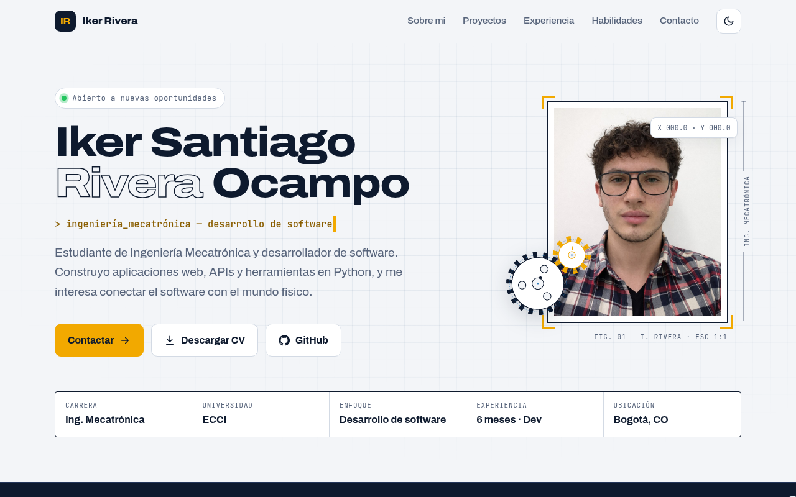

# Iker Rivera · Portfolio

[Español](README.md) · **English**

Personal portfolio of Iker Santiago Rivera Ocampo, Mechatronics Engineering student and software developer.

**🌐 [riveoca.github.io](https://riveoca.github.io)**



## What it includes

- Home section with general details and CV download.
- About me, projects, experience, education, skills and contact.
- Light and dark mode, and animations that turn off when the system asks for reduced motion.
- Responsive layout for mobile.

## How it is built

- HTML, CSS and JavaScript with no frameworks or build step.
- Hosted on GitHub Pages.
- **Projects:** generated from `config.js`, with language and last update filled in from the GitHub API.
- **CV:** the download button takes the PDF from a Google Docs document (`CV_URL` in `config.js`), so it updates without changing the repository.
- **Visits:** counter powered by GoatCounter.

## Run locally

```bash
python3 -m http.server 8000
```

Then open `http://localhost:8000`.

## License

The code is under the [MIT](LICENSE) license. The photo and CV are personal and are not covered by the license.
