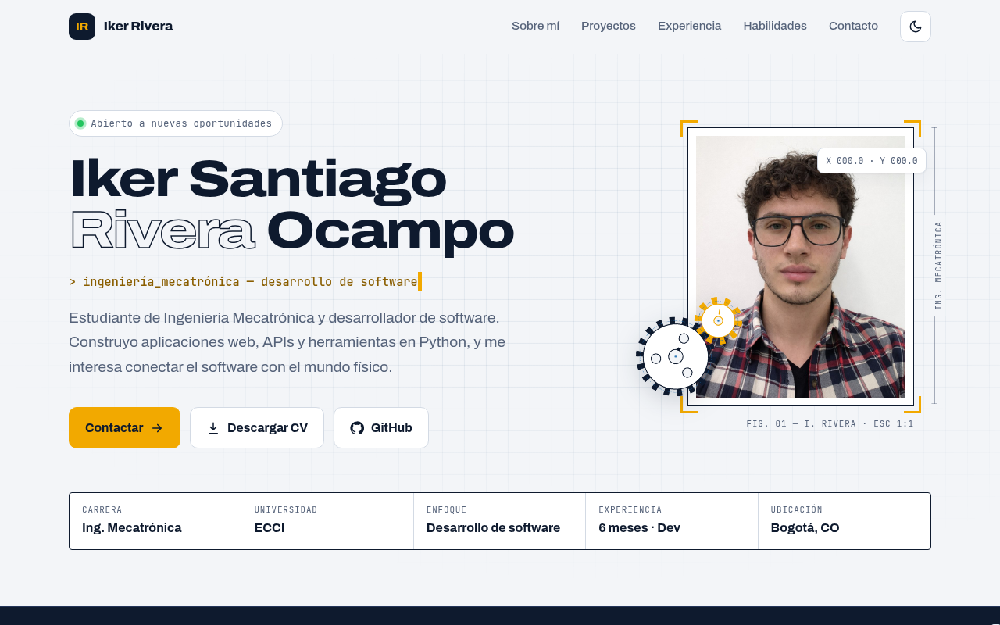

# Iker Rivera · Portafolio

**Español** · [English](README.en.md)

Portafolio personal de Iker Santiago Rivera Ocampo, estudiante de Ingeniería Mecatrónica y desarrollador de software.

**🌐 [riveoca.github.io](https://riveoca.github.io)**



## Qué incluye

- Portada con datos generales y descarga del CV.
- Sobre mí, proyectos, experiencia, formación, habilidades y contacto.
- Modo claro y oscuro, y animaciones que se desactivan si el sistema pide reducir el movimiento.
- Diseño adaptable a móvil.

## Cómo está hecho

- HTML, CSS y JavaScript sin frameworks ni dependencias de compilación.
- Publicado con GitHub Pages.
- **Proyectos:** se generan desde `config.js` y completan el lenguaje y la fecha de actualización con la API de GitHub.
- **CV:** el botón de descarga toma el PDF de un documento de Google Docs (`CV_URL` en `config.js`), así que se actualiza sin tocar el repositorio.
- **Visitas:** contador con GoatCounter.

## Ejecutar en local

```bash
python3 -m http.server 8000
```

Y abrir `http://localhost:8000`.

## Licencia

El código está bajo licencia [MIT](LICENSE). La foto y el CV son personales y no están incluidos en la licencia.
